# STELCO Legal Department Management System (LDMS) — Phase 0 Plan

| | |
|---|---|
| Status | **Draft, waiting for approval.** No application code is written until this plan is approved. |
| Scope of this document | Architecture, data model (ERD), roles and permissions, workflow state machines, STRIDE threat model, phased delivery plan, open questions. |
| Date | 2026-11-12 |

Contents

1. [Summary of key decisions](#1-summary-of-key-decisions)
2. [Architecture](#2-architecture)
3. [Data model (ERD)](#3-data-model-erd)
4. [Roles and permissions](#4-roles-and-permissions)
5. [Workflow state machines](#5-workflow-state-machines)
6. [SLA and business-day engine](#6-sla-and-business-day-engine)
7. [Security design](#7-security-design)
8. [Threat model (STRIDE)](#8-threat-model-stride)
9. [Phased delivery plan](#9-phased-delivery-plan)
10. [Testing strategy](#10-testing-strategy)
11. [Questions for you](#11-questions-for-you)

---

## 1. Summary of key decisions

I'm keeping the recommended stack. Where I depart from it, or where it leaves a choice open, the table gives the reason.

| Area | Decision | Why / trade-off |
|---|---|---|
| Monorepo | **pnpm workspaces** (`apps/web`, `apps/api`, `packages/shared`, `packages/db`). No Turborepo. | Easy to understand. Zod schemas, permission constants, state machines and the business-day calendar are shared by the front end and back end, so client and server rules can't drift apart. |
| Runtime | Node.js 24 LTS, TypeScript (strict). | Current LTS release. |
| Front end | Next.js (App Router), Tailwind, shadcn/ui, TanStack Table/Query, react-hook-form + zod, next-intl (all UI text in `messages/en.json`), Recharts. | As recommended. TanStack Table handles column choice, saved views and bulk selection. |
| **API exposure** | **Backend-for-frontend (BFF):** the browser only ever talks to the Next.js origin. Next.js forwards `/api/*` to NestJS over the internal network. **NestJS is never published, not even through the reverse proxy.** | Meets "only the web front end is exposed". It also gives one origin, so CORS and cookies stay simple. Cost: one extra internal hop, a few milliseconds. |
| Back end | NestJS: one module per unit plus core modules. A **separate worker process** (`main.worker.ts`) is built from the same codebase and runs BullMQ jobs. | Long jobs (scanning, OCR, imports, reports) can't slow down API requests. |
| Validation | **Zod everywhere** (`nestjs-zod` on the API), not class-validator. | One schema serves the form, the API and the importers. |
| Database | PostgreSQL 17 + Prisma. Full-text search via `tsvector` + GIN, and `pg_trgm` for fuzzy lookups by name or reference. FTS queries use Prisma's parameterised `$queryRaw` tagged templates; SQL is never built from strings. | As recommended. |
| Defence in depth for restricted matters | Central authorisation in the app, **plus PostgreSQL Row-Level Security (RLS)** on matter-scoped tables. Each request's user ID and roles are set with `set_config` inside its transaction. | If an app-layer check is ever missed, the database still won't return restricted rows. Cost: every request runs in a transaction (cheap at 70–200 users), and RLS adds work for migrations and tests. You can veto this (Q-B9). |
| Sessions / auth | **Server-side sessions** (opaque 256-bit token in a cookie; only its SHA-256 hash is stored in Postgres). Built from vetted primitives: `argon2` (Argon2id), `otplib` (TOTP), Node `crypto`. **I'm not using Auth.js or Lucia.** | Auth.js discourages credential logins and doesn't fit mandatory TOTP enrolment well. Lucia was deprecated by its author, who now recommends this exact pattern. Server-side sessions also give instant revocation (disabling a user ends their sessions). For Entra ID in Phase 8, an `Identity` table (provider + subject) is in place from day one, and `openid-client` will add OIDC + PKCE. |
| Jobs | Redis 7 + BullMQ: reminders, SLA scans, recurring compliance cycles, digests, AV scans, text extraction/OCR, imports, report rendering, email outbox. | As recommended. |
| Object storage | Code works against the **S3 API only** (AWS SDK v3). The storage backend is a deployment choice. | ⚠ **MinIO risk:** in late 2025 MinIO's open-source edition went into maintenance mode, and official community binaries and images stopped. Options: licensed MinIO AIStor, or an open S3 server (SeaweedFS, Garage, Ceph RGW). See Q-A4. MinIO stays in dev compose until you decide. |
| Antivirus | ClamAV (`clamd`, TCP INSTREAM via the `clamscan` npm package), with `freshclam` updating from an internal mirror or proxy. | As recommended. |
| Text extraction / OCR | A separate **extractor container**: `pdftotext` (poppler) for PDFs, `mammoth` for DOCX, **Gotenberg** (LibreOffice) to convert legacy `.doc`/`.xls`/`.ppt` to PDF, and `ocrmypdf` + Tesseract for scanned PDFs. | OCR is heavy on CPU and works on untrusted files, so it's isolated: no network, read-only filesystem, CPU and memory limits. |
| PDF reports | HTML templates rendered to PDF by **Gotenberg (Chromium)**, running internally. | The same charts appear in the UI and the PDF. It's one well-supported container instead of a hand-built PDF layout library. |
| Excel | `exceljs` for imports and exports. Exported cells are escaped against formula injection. | Maintained and on npm. The npm build of SheetJS is out of date. |
| Email parsing | `mailparser` (`.eml`), `@kenjiuno/msgreader` (`.msg`), server-side `DOMPurify` + `jsdom`. | Proven parsers. Email HTML is shown in an `iframe sandbox` (no scripts) with a restrictive CSP. |
| Word comparison | Both DOCX versions are converted to text with `mammoth` and compared paragraph by paragraph and word by word with `diff`. The result is a redline HTML view. | Shows **text** changes, not layout changes. A layout-accurate compare would need LibreOffice compare automation, which is heavier and less reliable. Can revisit if needed. |
| PDF watermark | `pdf-lib`, applied when the file is downloaded. | Simple and pure JavaScript. |
| `.ics` | `ics` npm package. | |
| Email | Nodemailer through the SMTP relay, using a transactional **outbox table** (retried by a worker). Can be switched off. | No email is lost if the relay is down, and nothing is sent if a transaction rolls back. |
| Tests | Vitest (unit, for both web and API through the SWC plugin), Supertest + **Testcontainers** (real Postgres, Redis, ClamAV) for integration, Playwright for end-to-end. | One test runner. Integration tests run against the real database, so RLS and constraints are tested too. |
| State machines | Plain typed transition tables in `packages/shared` (no XState), enforced by a server-side `WorkflowService`. | Easy to read, easy to audit and easy to test exhaustively. |

---

## 2. Architecture

### 2.1 Deployment topology (production)

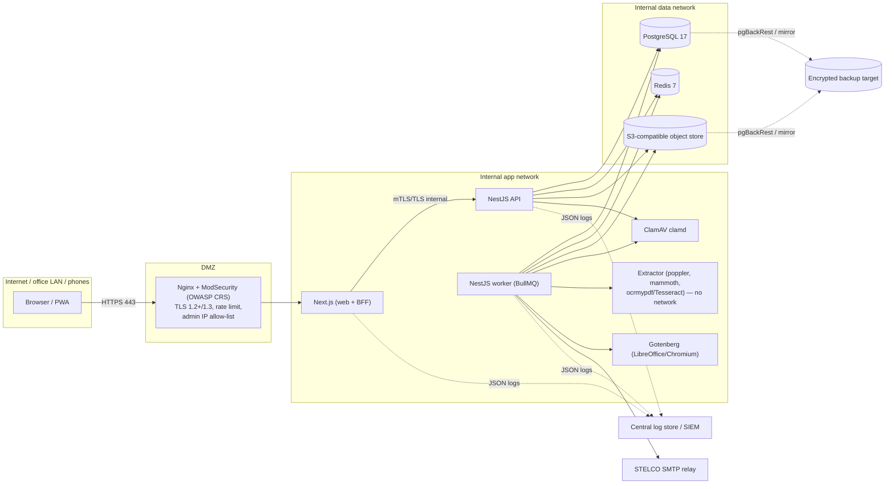

* Only the reverse proxy accepts inbound traffic. **Everything is TLS, including internal hops** (Postgres `sslmode=verify-full`, Redis TLS, S3 over HTTPS). An internal CA issues the certificates.
* The **file download path** is: browser → signed, short-lived URL served **through the web origin** (`/files/<signed-token>`), which Next.js proxies to the API, which streams from object storage. The object store is never exposed to browsers. Pre-signed S3 URLs would expose the storage host, so they aren't used.
* **Alternative to opening port 443:** a VPN or self-hosted zero-trust gateway in front of the same reverse proxy. Both are documented in `docs/IT_SETUP.md`. TOTP is still required either way.

### 2.2 Code structure

```
stelco-ldms/
  apps/
    web/                 Next.js app (App Router), BFF route handlers, PWA manifest + service worker
    api/                 NestJS: main.ts (HTTP) and main.worker.ts (BullMQ)
      src/core/          auth, users, rbac (policy), audit, documents, notifications, sla,
                         calendar, search, intake, matters, config, import, reports, crypto
      src/units/         litigation/, drafting/, compliance/, awareness/
  packages/
    shared/              zod schemas, enums, permission matrix, workflow tables,
                         business-day calendar, reference-number format
    db/                  prisma/schema.prisma, migrations, RLS SQL, seed scripts
  infra/
    docker/              Dockerfiles (non-root, read-only rootfs), compose.{dev,staging,prod}.yml
    nginx/               reverse proxy + ModSecurity CRS config
    extractor/           OCR/extraction image
  docs/                  PLAN, SECURITY, IT_SETUP, RUNBOOK, user guides
  .github/workflows/     CI (see 7.8)
```

### 2.3 Request pipeline (API)

`Helmet/headers → request-size limit → rate limiter (Redis) → CSRF/Origin check → SessionGuard (idle/absolute timeout, re-auth freshness) → PermissionGuard (@Can(action, resource) decorator: deny if none) → zod validation → controller → service (record-level policy + RLS tx) → AuditInterceptor → error filter (generic message + correlation ID)`

Each endpoint must declare a permission. **A CI test fails the build if any route has no `@Can(...)` or explicit `@Public()`.**

### 2.4 Intake adapter (built ready for Phase 8)

```ts
interface IntakeSource {
  readonly kind: 'MANUAL' | 'PORTAL' | 'GRAPH';
  // normalises a raw input into the canonical shape; no schema change for Graph later
  toIntake(input: unknown): Promise<NormalisedIntake>; // includes EmailMetadata
}
```

`ManualIntakeSource` handles the form and `.msg`/`.eml` uploads, and `PortalIntakeSource` handles requester submissions. `GraphIntakeSource` comes in Phase 8. `EmailMessage` stores `internetMessageId` (unique), `graphMessageId`, `conversationId`, sender and `receivedAt` **from now**. When Graph is added, a mail already entered by hand is matched by its `internetMessageId` and not duplicated.

### 2.5 Environments

| Env | How | Notes |
|---|---|---|
| dev | `docker compose -f compose.dev.yml up` | Mailpit catches email. MinIO stands in for S3. Seed demo data. Self-signed internal TLS. |
| staging | Same images as prod, on a STELCO server | Anonymised or demo data only. The ZAP baseline scan runs here. |
| prod | Compose on the STELCO servers (rootless Docker or Podman, Q-A3) | Secrets come from Vault or are injected at deploy time. Backups are on. |

Indicative sizing (70 users, growing to 200): **app host** 8 vCPU / 16 GB / 100 GB; **DB host** 4 vCPU / 16 GB / 250 GB SSD; **object storage** 1 TB to start; **DMZ proxy** 2 vCPU / 4 GB. All data volumes use LUKS encryption.

---

## 3. Data model (ERD)

Conventions: `cuid` primary keys (not guessable, which also makes IDOR harder), and `createdAt`/`updatedAt`/`createdById` on every table (left out of the diagrams below). Records that need retention get `deletedAt` (soft delete). Fields marked **🔒** use field-level encryption (AES-256-GCM envelope encryption, with a key ID kept so keys can be rotated).

### 3.1 Identity, access, audit, configuration

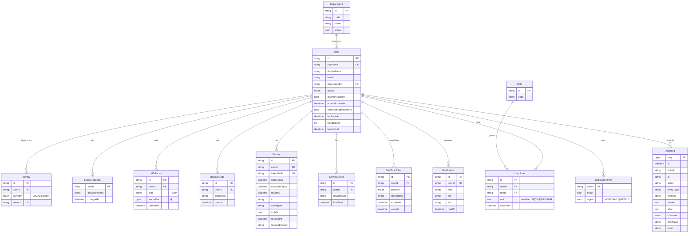

Configuration tables (admin-maintained, all audited): `RequestType(unit, code, name, slaPolicyId, active)`, `SlaPolicy(code, step, target, unit BUSINESS|CALENDAR, urgentHalves)`, `Holiday(date, name)`, `WorkCalendar(workdays, cutoffTime)`, `StatusDefinition(unit, code, label, order, isTerminal)`, `EmailTemplate(code, subject, body)`, `DocumentType(code, unit, allowedMime[])`, `ReminderSchedule(kind, offsetsDays[])`, `LawFirm`, `ExternalLawyer`, `Regulator`, `Court`, `Currency`, `ExchangeRate`, `RetentionPolicy(recordType, years, trigger)`, `SystemSetting(key, value)`.

### 3.2 Intake, matters, documents, SLA, calendar

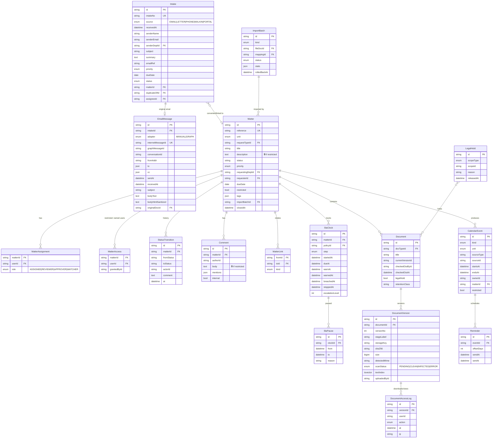

**Reference numbers:** `LGL-{UNIT}-{YEAR}-{SEQ}`, with unit codes `LIT`, `CMP`, `DRF`, `AWR` and SEQ padded to 4 digits (`LGL-DRF-2026-0042`). A `ReferenceSequence(unit, year, last)` row is incremented with `UPDATE … RETURNING` inside the creating transaction, so there are no gaps from races and no duplicates. Intakes get `LGL-INT-{YEAR}-{SEQ}` (Q-B3).

**Document ownership:** a `Document` has nullable foreign keys, one per owner type (`matterId`, `intakeId`, `lawId`, `sessionId`, `contractId`, `poaId`, `checkItemId`, …). A `CHECK` constraint requires exactly one of them to be set. This is plainer and safer than a polymorphic `entityType/entityId` pair, which can't have real foreign keys.

**Calendar:** `CalendarEvent` is a projection kept up to date by domain services whenever a hearing, deadline, contract, PoA, licence, check or session changes. Filtering and permission checks then happen in one place. The `restricted` flag is copied from the matter.

### 3.3 Litigation

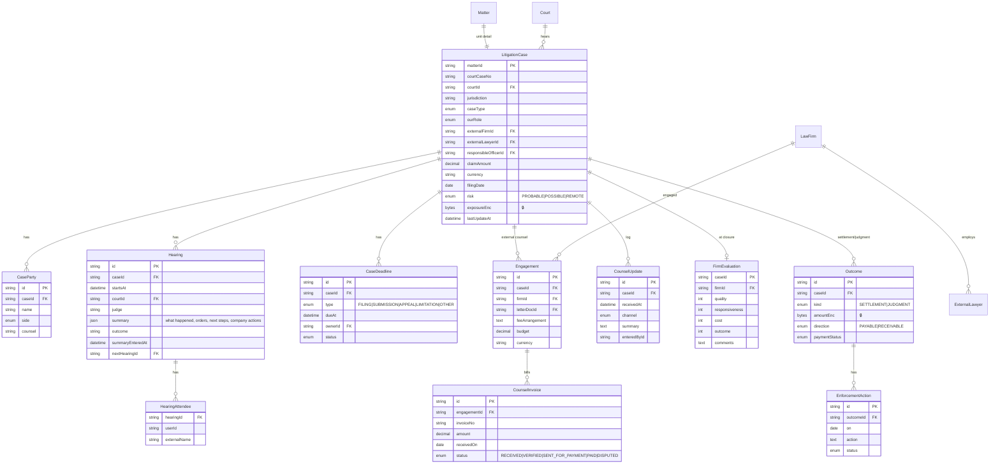

The import tables `ImportMapping(name, kind, columnMap json)` and `ImportRow(batchId, rowNo, raw json, errors json, action CREATE|SKIP|DUPLICATE, entityId)` support the dry run, the error report and rollback.

### 3.4 Drafting

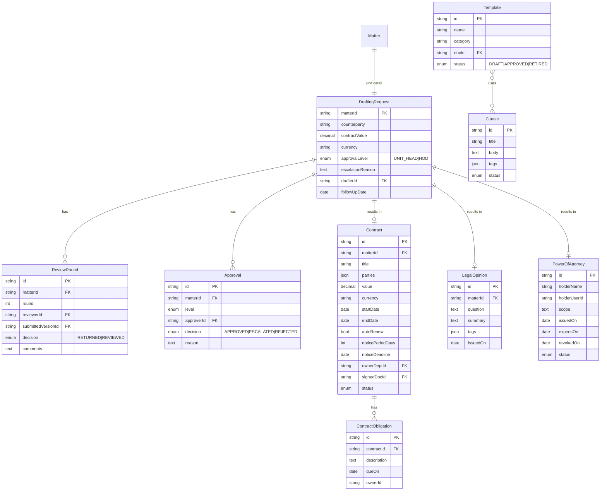

### 3.5 Compliance

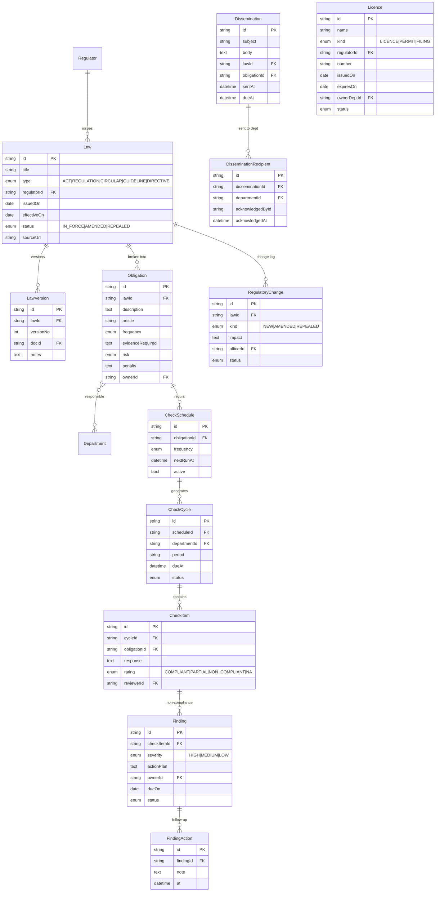

### 3.6 Awareness

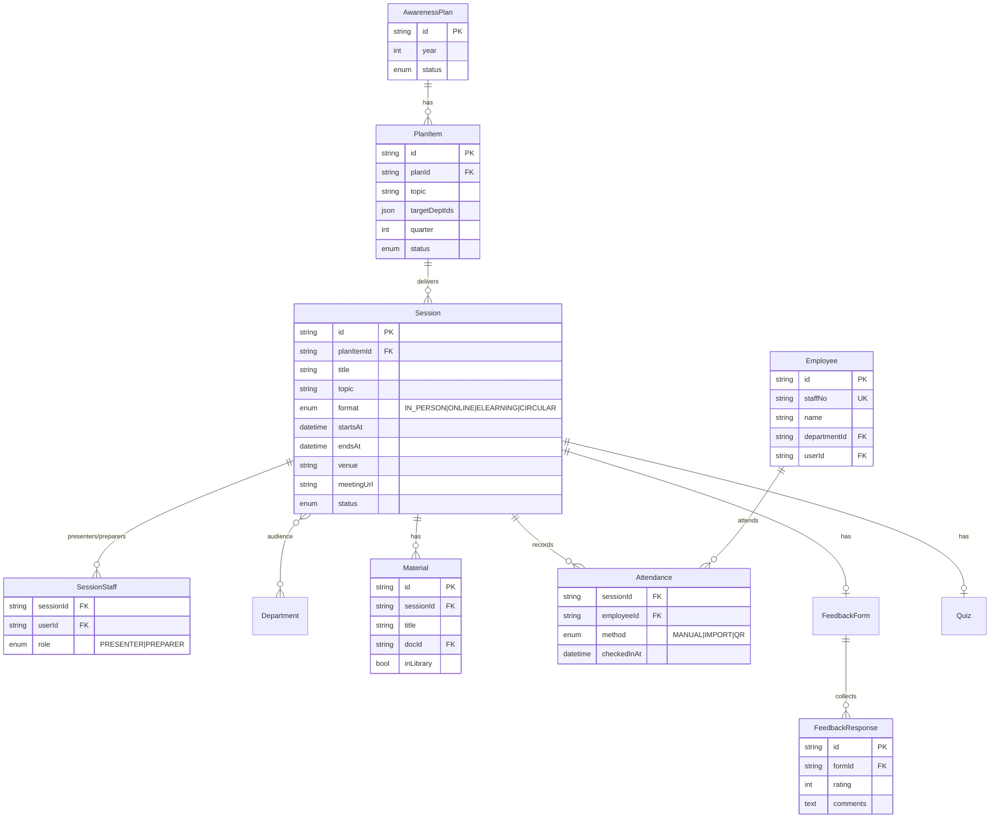

`Bulletin(title, body, audience, publishedAt)` and `FaqEntry(question, answer, tags)` sit alongside these.

---

## 4. Roles and permissions

### 4.1 Roles

| Code | Role | Unit-scoped? | Notes |
|---|---|---|---|
| `SUPER_ADMIN` | Super Admin (IT) | – | Can only be held by an `isAdminAccount` user. **Can't hold any legal role.** Sees no legal content. |
| `HOD` | Head of Legal | – | Sees everything, including all restricted matters. |
| `UNIT_HEAD` | Unit Head | yes | |
| `LEGAL_OFFICER` | Legal Officer / Lawyer | yes | |
| `PARALEGAL` | Paralegal / Clerk | yes | Also has the shared **intake inbox** (Q-B4). |
| `REQUESTER` | Department Requester / Focal Point | department | Portal only. Internal notes and comments are never shown. |
| `AUDITOR` | Auditor | – | Read-only. `accessExpiresAt` is required. Every read is logged. |
| `MGMT_VIEWER` | Management Viewer | – | Aggregate dashboards only. |

One user can hold several roles. For example, a Unit Head who also works as a lawyer gets `UNIT_HEAD` + `LEGAL_OFFICER` for that unit. **Separation of duties:** the API refuses to give `SUPER_ADMIN` and any legal role to the same user. When anyone is granted `HOD`, `UNIT_HEAD` or `AUDITOR`, the HoD is alerted, and the change is flagged in the access review.

### 4.2 Matrix

Key: ✅ full · **U** own unit · **A** matters assigned to / named on · **D** own department's requests (portal view) · **O** own submissions only · **R** read-only · **Σ** aggregates only · ❌ none.
**Restricted matters override every cell:** only users in `MatterAccess`, plus the HoD, can see them. For everyone else they're **invisible**: absent from lists, search, calendar, counts in detail lists, notifications and exports. A direct request returns `404`, not `403`.

| Capability | Super Admin | HoD | Unit Head | Legal Officer | Paralegal | Requester | Auditor | Mgmt Viewer |
|---|---|---|---|---|---|---|---|---|
| Users, roles, sessions (manage) | ✅ | R (view list) | ❌ | ❌ | ❌ | ❌ | R | ❌ |
| System config (SLA, holidays, templates, lists) | ✅ | ✅ | R | R | R | ❌ | R | ❌ |
| Audit log viewer | ❌ (only own admin actions, Q-B8) | ✅ | ❌ | ❌ | ❌ | ❌ | ✅ | ❌ |
| Access review report | ✅ | ✅ | ❌ | ❌ | ❌ | ❌ | ✅ | ❌ |
| Create intake | ❌ | ✅ | ✅ | ✅ | ✅ | O (portal) | ❌ | ❌ |
| Triage / convert / assign intake | ❌ | ✅ | U | ❌ | ✅ (convert, not assign to lawyer) | ❌ | R | ❌ |
| View matters | ❌ | ✅ | U | U | U | D (status view) | R (time-limited) | Σ |
| Edit matter | ❌ | ✅ | U | A | U (data entry) | ❌ | ❌ | ❌ |
| Assign / reassign | ❌ | ✅ | U | ❌ | ❌ | ❌ | ❌ | ❌ |
| Flag restricted / name users | ❌ | ✅ | U (then HoD notified) | ❌ | ❌ | ❌ | ❌ | ❌ |
| Drafting: draft | ❌ | ✅ | U | A | ❌ | ❌ | ❌ | ❌ |
| Drafting: review (checker) | ❌ | ✅ | U | A (as reviewer, not the drafter) | ❌ | ❌ | ❌ | ❌ |
| Drafting: approve | ❌ | ✅ | U (not if drafter/reviewer) | ❌ | ❌ | ❌ | ❌ | ❌ |
| Litigation: cases, hearings, summaries | ❌ | ✅ | U | U (edit if A) | U (data entry) | ❌ | R | Σ |
| Litigation: register import + rollback | ❌ | ✅ | U | ❌ | U (import; rollback = Unit Head) | ❌ | ❌ | ❌ |
| Counsel invoices: verify | ❌ | ✅ | U | A | U (record only) | ❌ | R | ❌ |
| Compliance: laws, obligations, findings | ❌ | ✅ | U | U | U (data entry) | ❌ | R | Σ |
| Dissemination: send | ❌ | ✅ | U | U | ❌ | ❌ | ❌ | ❌ |
| Acknowledge circular / answer checklist / upload evidence | ❌ | – | – | – | – | D | ❌ | ❌ |
| Awareness: plan, sessions, attendance | ❌ | ✅ | U | U | U | view own sessions | R | Σ |
| Documents: download | ❌ | ✅ | U | U | U | D (only docs shared to portal) | R (watermarked) | ❌ |
| Global search | ❌ | ✅ | U | U | U | D | R | ❌ |
| Dashboards | ❌ (system health only) | all | unit | My Work | My Work | portal | all (R) | HoD dashboard Σ |
| Excel export of lists | ❌ | ✅ | U | U | U | D | ✅ (logged) | Σ |
| Bulk export (re-auth required) | ❌ | ✅ | U | ❌ | ❌ | ❌ | ✅ | ❌ |
| Legal hold place/release | ❌ | ✅ | U (place only) | ❌ | ❌ | ❌ | ❌ | ❌ |
| Retention disposal approve | ❌ | ✅ | ❌ | ❌ | ❌ | ❌ | ❌ | ❌ |
| Leaver checklist: reassign open work | Starts the checklist (sees counts only) | ✅ | U | ❌ | ❌ | ❌ | ❌ | ❌ |

Implementation: permissions are code constants (`matter:read`, `drafting:approve`, …) mapped to roles in `packages/shared/permissions.ts`. The PermissionGuard checks the action. A `PolicyService` builds Prisma `where` scopes for each record (unit / assigned / department / restricted). RLS enforces the restricted rule a second time in the database.

---

## 5. Workflow state machines

Every transition is checked by the server-side `WorkflowService` (guards plus required fields) and writes a `StatusTransition` row and an `AuditLog` entry (who, when, comment).

### 5.1 Intake

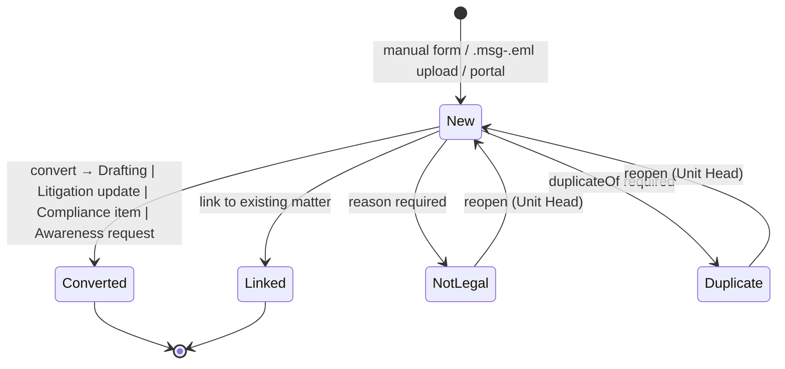

SLA: the *Register and acknowledge* clock (1 business day) starts at `receivedAt`. The *Assign* clock (1 business day) starts when the intake is converted.

### 5.2 Drafting request

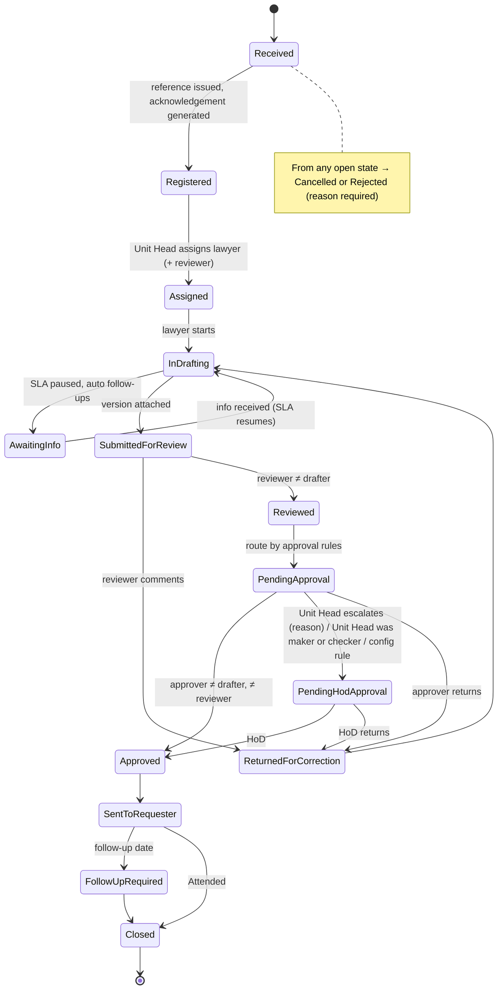

*Pending HoD approval* is modelled as a sub-state of *Pending Approval*, so the 11 steps you listed stay as written. Guards enforced in `WorkflowService` and covered by tests:
* `reviewerId ≠ drafterId`, and `approverId ∉ {drafter, reviewer}`. If the Unit Head is the maker or checker, routing goes to `PendingHodApproval` automatically.
* `SubmittedForReview` requires a new `DocumentVersion` (stage `DRAFT_vN`). `Reviewed` stores stage `REVIEWED`. `Approved` requires a `FINAL` version.
* Optional rules for sending straight to the HoD (contract value ≥ X, restricted, request type in a list) are config entries, **off by default**.

### 5.3 Litigation case (statuses can be configured; these are the defaults)

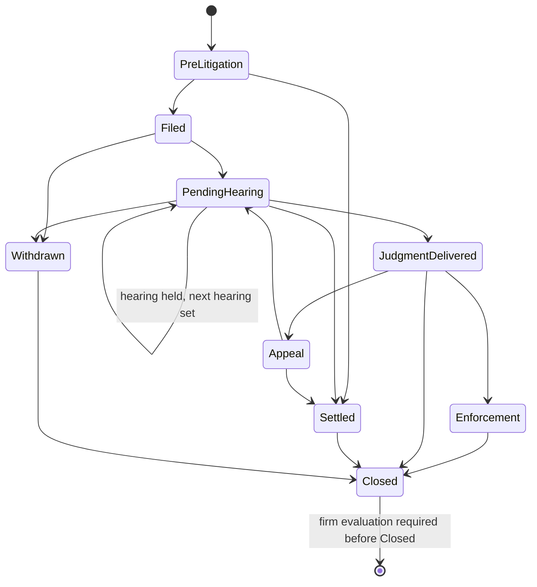

Hearing sub-flow: `Scheduled → Held (summary due in 2 business days) → SummaryEntered`. A missing summary is flagged at the deadline and escalated. Setting `nextHearingAt` creates the next `Hearing` and its `CalendarEvent`. A case with no `CounselUpdate`, hearing or status change for 30 days is flagged.

### 5.4 Compliance: dissemination, check cycle, finding

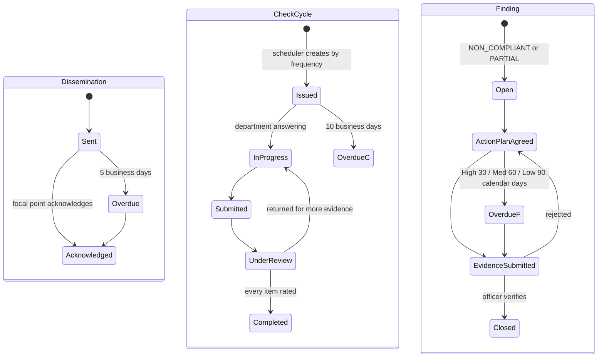

Regulatory change: `Identified → ImpactAssessment → Communicated → Implementing → Implemented`.

### 5.5 Awareness session

`Planned → Scheduled (presenters assigned) → MaterialsReady (≥5 business days before) → Held → FeedbackCollected → Closed`, plus `Cancelled` / `Postponed`.

### 5.6 Documents and accounts

* **Document version:** `Uploaded → Quarantined → (Clean → Available, text extracted/OCR'd) | (Infected → Blocked, alert) | (ScanError → retried 3×, then Blocked)`. A file can't be downloaded until it's `Clean`.
* **User account:** `PendingSetup → Active (TOTP enrolled) ⇄ Locked (15 min) → Disabled` (all sessions revoked at once). `Disabled` requires the leaver checklist to be completed, or overridden by the HoD with a reason.

---

## 6. SLA and business-day engine

* `packages/shared/calendar.ts` holds pure functions: `isBusinessDay`, `addBusinessDays`, `businessDaysBetween`. Workdays are Sunday to Thursday (configurable), minus `Holiday` dates. The time zone is fixed to `Indian/Maldives` (no DST). A due date falls at the **end of the business day** (configurable cut-off, default 16:00, Q-B1).
* `SlaClock` has one row per matter **per step** (register/ack, assign, drafting type, review, approval, hearing summary, …).
  `dueAt = addBusinessDays(startedAt, target) + total paused time`. Pauses (Awaiting Information) are stored in `SlaPause`, and the deadline is recalculated in business time when the clock resumes.
* **Urgent priority:** target = `max(1, ceil(target / 2))` (Q-B2).
* **Calendar-day policies** (finding remediation, the 30-day "no update" flag) use the same engine with `unit = CALENDAR`.
* A BullMQ repeatable job runs every 10 minutes. At **75%** of elapsed business time it sends a warning to the assignee. At **100%** it marks a breach and notifies the assignee and the Unit Head. At **100% plus 1 business day** it escalates to the HoD (Q-B5). Both escalation steps are idempotent (`warnedAt`, `escalationLevel`).
* The engine has property-based tests (fast-check), plus fixed cases around weekends, Eid holidays and the turn of the year.

---

## 7. Security design

Target: **OWASP ASVS 4.0.3 Level 2**. A requirement-by-requirement checklist will be kept in `docs/SECURITY.md`.

### 7.1 Authentication
* **Passwords:** at least 12 characters, at most 128. Checked offline against a bundled list of common and breached passwords (a top-1M list plus STELCO-specific words), stored as a Bloom filter in the image. **Argon2id** (m=64 MiB, t=3, p=1; parameters stored per hash so they can be raised later). No composition rules and no forced expiry, but a change is forced after a reset or a suspected compromise.
* **TOTP is mandatory** at first sign-in (RFC 6238, SHA-1, 6 digits, 30 seconds, ±1 step). The secret is encrypted at rest 🔒. **A code can't be reused** within its window (the last-used step is stored). You get 10 backup codes (each 10 characters, from Crypto RNG), shown once and stored as Argon2id hashes.
* **Sign-in flow:** username + password → (password OK) → a short-lived "pending MFA" session (5 min) → TOTP or backup code → full session. Every failure returns the same generic message with the same timing (a dummy hash is checked for unknown users).
* **Lockout:** after 5 failures the account is locked for 15 minutes. Delays grow with each failure (1, 2, 4, 8 s). There is also a per-IP throttle, so one attacker can't easily lock out many accounts. Admins are alerted when an account locks out ≥3 times in 24 hours.
* **Setup and reset tokens:** 256-bit random, only the hash stored, single use. A setup link lasts 24 hours and a self-service reset link 30 minutes (only if SMTP is on). Admin resets are audit-logged and the user is notified.
* **Admin accounts** are separate (for example `adm.jdoe`). Optionally, admin routes are restricted to office IP ranges.
* **Ready for Phase 8:** `Identity(provider = ENTRA, subject = oid)` links to the existing `User` by verified email. Roles will map from Entra groups through a mapping table. Local passwords are then switched off except for one break-glass admin account, whose use raises an alert.

### 7.2 Sessions
* The cookie is `__Host-ldms_sid`, with `HttpOnly; Secure; SameSite=Strict; Path=/`. It holds an opaque token; the database stores only its hash.
* Idle timeout is 15 minutes (5 on mobile, Q-B7), absolute timeout 8 hours. Both are configurable. The session ID rotates at login and at privilege change.
* Users can see their sessions and devices and sign out others. Admins can revoke any session. Disabling a user revokes all their sessions within the same transaction.
* A sign-in from a new device (hash of user agent family + a long-lived random device cookie) sends a notification.
* **Re-authentication** (password + TOTP within the last 5 minutes) is required for bulk export, role changes, deletion, the audit log viewer, placing or releasing legal holds, and disposal.

### 7.3 Authorisation
Deny by default. Central guards (§2.3) plus record scopes in `PolicyService`, plus RLS for restricted matters. **IDOR test suite:** for every resource route, a generated matrix calls the route as each role and user persona, including users of another unit, other departments, users not named on a restricted matter, expired auditors and disabled users. It asserts `404`/`403` and checks that nothing leaks through list, search, calendar, export, notifications or counts.

### 7.4 Application security
* Zod validation on every input. Unknown keys are rejected (stops mass assignment). Sizes are limited: 1 MB for JSON bodies, and a per-type limit for uploads (default 50 MB, Q-C3).
* **CSP with nonces** generated in Next.js middleware: `default-src 'self'; script-src 'nonce-…' 'strict-dynamic'; object-src 'none'; frame-ancestors 'none'; base-uri 'none'`. No `unsafe-inline`. HSTS (1 year, includeSubDomains), `X-Frame-Options: DENY`, `Referrer-Policy: no-referrer`, `Permissions-Policy` (camera only on the QR check-in page), `X-Content-Type-Options: nosniff`.
* **CSRF:** `SameSite=Strict`, plus an Origin/`Sec-Fetch-Site` check, plus a double-submit token on every state-changing request.
* **CORS:** none, because the app has a single origin and cross-origin requests are rejected.
* **Rate limits:** Nginx `limit_req` per IP, plus `@nestjs/throttler` with Redis per user and per IP. Login, reset and MFA routes have stricter limits.
* **Email HTML:** sanitised server-side with DOMPurify (scripts, forms, event handlers, styles with `url()`, `<base>`, `<meta>` removed). Remote images are replaced with placeholders. It's shown in `<iframe sandbox srcdoc>` with an inner CSP of `default-src 'none'; img-src data:; style-src 'unsafe-inline'`. That inner policy is scoped to the sandboxed frame only and can't run script.
* **Errors:** a generic message with a correlation ID. Stack traces only go to the server logs, with personal data removed.
* **Excel exports** escape cells starting with `= + - @ \t \r` to stop formula injection. Excel imports never evaluate formulas, and the XML parser is safe against XXE.

### 7.5 Files
An allowlist checked by **magic bytes** (`file-type`) **and** extension: PDF, DOCX, XLSX, PPTX, DOC, XLS, PPT, MSG, EML, PNG, JPEG, TXT, CSV. **No macro-enabled formats** (`.docm`, `.xlsm`). OLE files with VBA streams are rejected. Limits on archive bombs: the ZIP-based OOXML formats are checked for entry count, uncompressed size and compression ratio. Files go to a quarantine bucket, are scanned by ClamAV, and are only promoted to `Clean` if they pass. Object keys are random IDs (the original filename is kept only as metadata). Downloads use HMAC-signed tokens bound to the user, that version and a 60-second TTL, are streamed with `Content-Disposition: attachment`, and every download is logged. PDFs can optionally be watermarked. Legal hold blocks deletion at both the service level and the database level (trigger).

### 7.6 Data protection
* TLS 1.2+ (1.3 preferred) on every hop, including internal ones.
* **At rest:** LUKS full-disk encryption on database, object storage and backup volumes, because community PostgreSQL has no TDE. Server-side encryption on the object store if the chosen backend supports it. Backups are encrypted with pgBackRest repository encryption.
* **Field-level encryption** 🔒 (AES-256-GCM envelope encryption; data keys are wrapped by a key-encryption key from Vault or an injected secret; there's a `keyId` per value and a rotation job): TOTP secrets, settlement and judgment amounts, exposure estimates, and the description and comments of restricted matters. The list is configurable (Q-C1). **Trade-off:** encrypted fields can't be searched with full-text search or sorted in SQL. Exposure totals are computed in the app after decryption, which is fine at this data size.
* **Logs:** structured JSON (pino) with redaction rules for tokens, passwords, cookies, email bodies and document text. Logs are shipped to the SIEM (syslog/GELF, Q-A6).
* Secrets live in HashiCorp Vault if available (Q-A5), otherwise in environment variables or Docker secrets injected at deploy time. `.env.example` holds no real values, and gitleaks runs in CI and pre-commit.

### 7.7 Audit log
* An `audit_log` table with `seq BIGSERIAL`. `hash = SHA-256(prevHash ‖ canonical JSON(entry))`. Inserts are serialised with a transaction-scoped advisory lock.
* The application's database role has **INSERT and SELECT only**. `UPDATE`, `DELETE` and `TRUNCATE` are revoked, and a trigger raises an error if anyone tries them.
* A nightly verification job walks the chain. The daily head hash is written to the SIEM, so tampering by a database superuser is detected outside the database.
* Events recorded: every create/update/delete (before and after values, with 🔒 fields masked), views of restricted items, downloads, exports, permission changes, logins and logouts, MFA events, failed access attempts, admin actions, imports and rollbacks.
* The viewer (HoD and Auditor, re-authentication required) can filter by actor, entity, action and date, and can export results.

### 7.8 Pipeline and infrastructure
CI (GitHub Actions by default; ported to GitLab CI or Gitea if needed, Q-A2): lint → typecheck → unit → integration (Testcontainers) → end-to-end (compose) → **CodeQL** → **`pnpm audit`** + Dependabot → **gitleaks** → image build → **Trivy** (fail on HIGH/CRITICAL that have a fix) → SBOM (Syft) → on staging, **OWASP ZAP baseline**. Images are pinned by digest and the lockfile is enforced (`--frozen-lockfile`). Containers run as non-root with a read-only root filesystem, `no-new-privileges`, and all Linux capabilities dropped. Backups: pgBackRest full weekly, differential daily, and continuous WAL archiving; the object store is mirrored nightly; there's a **monthly automated restore test** into staging. Proposed targets are **RPO 15 min, RTO 4 h** (Q-A7).

---

## 8. Threat model (STRIDE)

Assets: legal matters (especially restricted ones), litigation exposure, contracts, credentials and TOTP secrets, audit trail, documents. Trust boundaries: Internet → DMZ proxy → web/BFF → API → data stores; untrusted inputs from uploaded files, email files and Excel imports.

| # | Threat | Example | Mitigations |
|---|---|---|---|
| **S1** | Spoofing | Credential stuffing or password spraying from the internet | Breached-password check, mandatory TOTP, lockout + per-IP throttling, WAF, generic errors, lockout alerts |
| S2 | Spoofing | Real-time phishing that relays the TOTP code | Short pending-MFA window, new-device notification, user can see sessions; Phase 8: Entra phishing-resistant MFA via Conditional Access. **Residual risk accepted for v1** |
| S3 | Spoofing | Stolen session cookie (shared PC, XSS) | HttpOnly + `__Host-` prefix, strict CSP, idle and absolute timeouts, sign out other sessions, admin revocation |
| S4 | Spoofing | Forged email in an uploaded `.msg`/`.eml` | Parsed sender data is shown as "claimed" and staff confirm it; no automatic actions are triggered from email content |
| **T1** | Tampering | Changing or deleting audit entries | INSERT-only database role, trigger, hash chain, nightly verification, head hash kept in SIEM |
| T2 | Tampering | Skipping a workflow step (self-approval) | Server-side state machine guards, maker-checker checks, tests for every illegal transition |
| T3 | Tampering | Mass assignment (`restricted=false`, `status=Approved` in an edit request) | Strict zod schemas per action (no generic update endpoint) |
| T4 | Tampering | Malicious upload (macro, polyglot, zip bomb) | Magic-byte allowlist, no macro formats, ClamAV, archive limits, isolated extractor with no network |
| T5 | Tampering | Changing a file in storage directly | Object store reachable only internally, SHA-256 stored per version and checked on download |
| **R1** | Repudiation | "I didn't approve that" | Every transition logged with actor, IP, session ID and comment; re-auth for sensitive actions |
| R2 | Repudiation | Admin denies changing a role | Role changes need re-auth, are audited, and the HoD is alerted |
| **I1** | Information disclosure | IDOR: guessing or iterating IDs | cuid IDs, central policy, RLS, IDOR test matrix, `404` for restricted records |
| I2 | Information disclosure | Restricted matter leaking through search, calendar, notifications, counts, export or autocomplete | One `PolicyService` scope used by **every** read path, plus RLS; tests that seed restricted matters and assert they're absent everywhere |
| I3 | Information disclosure | Super Admin reading legal content | No legal permissions for admin roles; SoD stops admin + legal roles together; the HoD is alerted to legal-role grants; field-level encryption limits what database administrators can read |
| I4 | Information disclosure | Stored XSS from email HTML or comments | Server-side DOMPurify, sandboxed iframe, React escaping, CSP with nonces |
| I5 | Information disclosure | Documents cached on a phone or shared PC | `Cache-Control: no-store` on authenticated pages and files; service worker caches only static assets; shorter idle timeout on mobile |
| I6 | Information disclosure | Signed URL leaked (forwarded or in history) | 60-second TTL, bound to the user's session, served through the app origin |
| I7 | Information disclosure | Sensitive data in logs, errors or backups | Log redaction, generic errors, encrypted backups |
| I8 | Information disclosure | Mass download by an insider | Rate limits on downloads, alerts on mass downloads or exports, watermarking, re-auth for bulk export |
| I9 | Information disclosure | Inferring restricted matters from aggregates (Management Viewer) | Aggregates either leave out restricted matters or put them in an "Other / confidential" bucket (Q-B7a) |
| **D1** | Denial of service | Login flood or deliberate lockout of key users (HoD) | Per-IP throttling before the account lock, WAF, alerts; admin can unlock |
| D2 | Denial of service | Very large uploads or OCR exhausting CPU | Size limits, a queue with concurrency 1–2 for OCR, page limit per OCR job, CPU and memory limits on the extractor |
| D3 | Denial of service | Expensive search queries | Query length limits, pagination, statement timeout |
| **E1** | Elevation of privilege | Admin creates an account with HoD rights and uses it | SoD: admin accounts can't hold legal roles; HoD, Unit Head and Auditor grants alert the HoD and appear in the quarterly access review; optional two-person approval (Q-B6) |
| E2 | Elevation of privilege | A requester reaches the internal API | Portal DTOs are separate; requester permissions are a strict subset; IDOR tests run as requester |
| E3 | Elevation of privilege | Auditor's access outlives the audit | `accessExpiresAt` is required and enforced at every request |
| E4 | Elevation of privilege | A compromised container moves sideways | Non-root, read-only filesystem, network segmentation, least-privilege database roles (migration role separate from app role) |
| E5 | Elevation of privilege | Supply-chain attack through a dependency | Lockfile, Dependabot, `pnpm audit`, Trivy, pinned image digests, SBOM, `ignore-scripts` by default |

---

## 9. Phased delivery plan

After each phase I'll report: what was built, how to run it, test results, and open issues. Then I wait for your go-ahead.

| Phase | Deliverables | Exit criteria |
|---|---|---|
| **0. Plan** | This document, the initial `CLAUDE.md` | Your approval and answers to the 🔴 questions |
| **1. Foundation + manual intake** | Monorepo, Docker Compose (dev), Dockerfiles, CI with all scanners · Auth: local accounts, Argon2id, mandatory TOTP + backup codes, lockout, setup/reset tokens, sessions UI, re-auth · Users, roles, departments, SoD, leaver checklist, access review report · PolicyService + RLS + IDOR test harness · Hash-chained audit log + viewer · Documents: upload pipeline (magic bytes, ClamAV, quarantine, versions, check-in/out, signed downloads, legal hold) · Notifications (in-app + SMTP outbox + digests) · Business-day calendar + SLA engine · Admin configuration screens · Base layout (responsive, PWA shell, i18n, accessibility) · Intake form, `.msg`/`.eml` parsing + sanitised preview, triage inbox, acknowledgement template + "Copy reply", `IntakeSource` adapters · Seed data | All tests green, including IDOR and end-to-end tests for login + TOTP enrolment, intake → triage. `SECURITY.md` and `IT_SETUP.md` drafted |
| **2. Litigation + import** | Case register, parties, hearings + summary template + next-hearing auto-scheduling, deadlines with escalation, engagements, invoices, counsel update log, firm evaluation, settlements and judgments, exposure report (Excel/PDF), "no update for X days" report · **Excel register import:** column mapping (saved), dry run, duplicate detection, create-on-the-fly reference data, batch tagging, rollback, error report | End-to-end tests for import and rollback, and for hearing → summary reminder |
| **3. Drafting** | Full state machine with maker-checker and HoD escalation, staged versions, Word comparison, templates and clause library, contract repository + renewal/notice reminders, PoA register, opinions register, requester portal (submit, status, documents shared to portal) | End-to-end tests for each approval route and every illegal transition |
| **4. Compliance** | Laws register + versions, obligation library, regulatory change log, dissemination + acknowledgement tracking + reminders, recurring check cycles, review and rating, findings and remediation, licences register, compliance dashboard and heat map | End-to-end tests: law → obligation → cycle → finding → closure |
| **5. Awareness** | Annual plan, sessions, presenters, materials library, attendance (manual, Excel, QR), feedback + quiz, staff training history, bulletins and FAQ, reports | End-to-end tests including QR check-in on a mobile viewport |
| **6. Cross-cutting** | Unified calendar + `.ics`, reminders at 30/14/7/1/0 days, HoD/unit/My Work dashboards, global search with OCR, monthly and annual management reports (PDF/Excel), saved views, bulk actions, other importers (contracts, laws, staff) | Search permission tests, report snapshot tests |
| **7. Hardening + go-live** | ASVS L2 checklist and self pen-test, ZAP full scan, load test (k6, 200 users), backup/restore drill with RPO/RTO measured, production deployment runbook, `RUNBOOK.md`, user guides for each role, real register import | Sign-off checklist |
| **8. Microsoft 365** *(only when you ask)* | Entra ID single sign-on (OIDC + PKCE), group→role mapping, break-glass account, Graph mailbox ingestion with an Application Access Policy, threading and reference matching, sending from the shared mailbox, Outlook calendar sync | — |

---

## 10. Testing strategy

| Layer | Tooling | Covers |
|---|---|---|
| Unit | Vitest (+ fast-check) | Business-day calendar, SLA maths, state machine tables, permission matrix, reference formatting, sanitiser, import mapping and validation |
| Integration | Vitest + Supertest + Testcontainers (Postgres, Redis, ClamAV with the EICAR test file, MinIO) | Every API route: happy path, validation, **IDOR matrix**, RLS, audit entries written, hash chain verified |
| End-to-end | Playwright (desktop Chromium + mobile Pixel/iPhone viewports), axe-core for accessibility | Every main workflow per phase |
| Security | CodeQL, gitleaks, Trivy, `pnpm audit`, ZAP baseline | CI gates |
| Performance | k6 (Phase 7) | p95 < 500 ms for list views at 200 concurrent users |

A route-coverage test fails if any controller route has no IDOR test entry.

---

## 11. Questions for you

🔴 = needed before Phase 1 starts. 🟡 = needed during Phase 1 (I'll use the stated default until you answer). ⚪ = later phases.

### A. Infrastructure and repository
1. 🔴 **Repository:** this repo (`Trial2`) already holds an unrelated ESP32 project. I've put the LDMS in `stelco-ldms/`. OK to keep it here, or should it move to its own repository?
2. 🔴 **Git server / CI:** GitHub Actions, or STELCO's own Git server (GitLab, Gitea, Azure DevOps)? Is there an internal container registry?
3. 🟡 **Server OS and container runtime:** RHEL-family or Ubuntu? Docker Engine or Podman (rootless)? Is Docker Compose acceptable to IT for production, or do they have Kubernetes or another orchestrator?
4. 🔴 **Object storage:** given MinIO's community edition status (§1), which do you prefer: licensed MinIO AIStor, SeaweedFS, Garage, Ceph RGW, or an existing STELCO S3-compatible appliance or NAS?
5. 🟡 **Secrets:** is HashiCorp Vault (or another secrets store) available on-premises? If not, I'll use Docker secrets injected at deploy time.
6. 🟡 **Publishing for remote access:** reverse proxy + WAF in the DMZ (default), or VPN? Is there an existing WAF or load balancer (F5, FortiWeb, …) to reuse? What SIEM or log store (and protocol) should logs go to?
7. 🟡 **Backups:** are RPO 15 min / RTO 4 h acceptable? Where should backups go (second site, NAS, tape)?
8. 🟡 **SMTP relay:** host and port, TLS/auth requirements, and the from-address (e.g. `no-reply-legal@stelco.com.mv`).
9. ⚪ Internal mirror for ClamAV signature updates and Tesseract language packs, or is outbound internet allowed for those?

### B. Business rules
1. 🟡 **Working hours:** what time is the end of the business day for deadlines (default 16:00)? Do Ramadan working hours change anything?
2. 🟡 **Urgent priority rounding:** is halving rounded up (5 → 3 days)?
3. 🔴 **Reference numbers:** OK for intakes to get `LGL-INT-YYYY-NNNN` and matters `LGL-{LIT|CMP|DRF|AWR}-YYYY-NNNN` at conversion, with the acknowledgement quoting the **matter** reference? Or should the acknowledgement go out at intake with the intake reference? Does SEQ restart every year, and are 4 digits enough?
4. 🟡 **Intake inbox visibility:** do all paralegals and Unit Heads see the shared intake inbox before triage? Is each paralegal attached to one unit, or do some serve the whole department?
5. 🟡 **Escalation chain:** breach → Unit Head at once, then HoD after 1 more business day (default)? Or both at once?
6. 🟡 **Granting HoD, Unit Head or Auditor roles:** alert the HoD (default), or require the HoD to approve before the grant takes effect (two-person rule)?
7. 🟡 **Management Viewer aggregates:** leave restricted matters out completely, or count them in a "Confidential" bucket? Is the default mobile idle timeout of 5 minutes OK?
8. 🟡 **Super Admin and the audit log:** you've said no legal content for admins. May admins see audit entries for *system* events only (logins, user and role changes)? That's my default.
9. 🟡 **RLS:** OK to add PostgreSQL Row-Level Security as a second layer for restricted matters (recommended, §1)?
10. 🟡 **Requester visibility:** does every requester see *all* of their department's requests, or only focal points, with ordinary requesters seeing only their own?
11. 🟡 **Auditor:** may an auditor see restricted matters if they're named on them? What's the default access period (e.g. 30 days)?

### C. Data and security details
1. 🟡 **Field-level encryption list:** TOTP secrets, settlement and judgment amounts, exposure estimates, and the description and comments of restricted matters. Anything to add, such as claim amounts or party names on restricted cases?
2. 🟡 **Currencies:** MVR and USD? For exposure totals, should I use manually entered exchange rates by month?
3. 🟡 **File types and size:** is the allowlist in §7.5 and a 50 MB per-file limit OK? Should legacy `.doc`/`.xls` be accepted?
4. ⚪ **Retention periods** per record type (for example closed cases 10 years, contracts 7 years after expiry). Do Maldivian legal or archival rules apply? I'll seed placeholders.
5. 🔴 / Phase 2 **Litigation register headers:** please send the real column headers (and, if possible, 5–10 anonymised rows). Until then I'll build against the sample columns you listed.
6. ⚪ **Employee directory for awareness:** training history needs all staff, not only the ~70 users. Is there an HR export (staff no., name, department) I can import? Should QR check-in work for staff **without** an app account (for example a check-in page that asks for staff number, valid only during the session)?
7. ⚪ **Branding:** STELCO logo, colours and fonts for the UI and PDF reports.
8. ⚪ **HoD shortcut thresholds:** if contract-value rules are switched on later, which currency and amount?
9. ⚪ **Admin IP allowlist:** office network ranges, if you want this switched on.

---

*End of Phase 0. I'm stopping here for your approval and answers to the 🔴 questions before writing any application code.*
